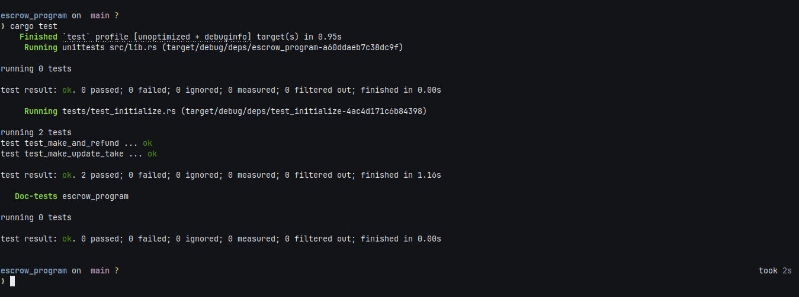

# Solana Anchor Escrow

An on-chain Solana escrow program built with the Anchor framework and SPL Token Interface. This project implements a trustless token exchange supporting all four core escrow lifecycle instructions (**make**, **take**, **refund**, and **update**) using Program Derived Addresses (PDAs) and Token CPIs with PDA signing.

---

## Assignment Overview

The assignment requirements:
> **2. Write the escrow program with all instructions (make, take, refund, update).**  
> **3. Write tests covering all the instructions using either Typescript or Rust using LiteSVM.**

- **`make`**: Initializes the `Escrow` state account and a `vault` Associated Token Account (ATA) owned by the escrow PDA. Transfers the deposit amount of Token A (`mint_a`) from the maker to the vault via `transfer_checked`.
- **`take`**: The designated taker executes the trade by sending the required Token B (`mint_b`) amount to the maker. The escrow PDA signs via seeds (`[b"escrow", maker, seed, &[bump]]`) to release Token A from the vault to the taker, then closes both the vault and the escrow state accounts, returning rent lamports to the maker.
- **`refund`**: Allows the maker to cancel an open escrow. The escrow PDA signs via seeds to return the deposited Token A from the vault back to the maker, then closes both the vault and escrow state accounts, reclaiming all rent lamports.
- **`update`**: Allows the maker to adjust the expected `receive` amount of Token B before the escrow is taken or refunded.

---

## Prerequisites

- **Rust**: 1.80+
- **Solana CLI**: 1.18+ / 2.0+
- **Anchor CLI**: 0.30+ / 1.1+

---

## Setup

Ensure your local keypair exists:

```bash
solana-keygen new --outfile ~/.config/solana/id.json
```

---

## Build & Test

Tests use **LiteSVM** for fast in-process VM execution without running a local validator.

### 1. Build the Program

Compile the Solana program into SBF bytecode (`target/deploy/escrow_program.so`):

```bash
anchor build
```

> **Note:** `anchor build` must be run before tests because `test_initialize.rs` embeds `escrow_program.so` at compile time via `include_bytes!`.

### 2. Run Tests

Execute the Rust test suite using LiteSVM:

```bash
cargo test
```

*(or run `anchor test`)*

### 3. Test Results

Screenshot showing all tests passing:



---

## Instructions Summary

| Instruction | Description | Key Accounts & Signers |
| :--- | :--- | :--- |
| **`make`** | Initializes `Escrow` PDA and `vault` ATA; deposits Token A via `transfer_checked`. | `maker` (Signer), `taker`, `mint_a`, `mint_b`, `maker_ata_a`, `escrow` (PDA), `vault` (PDA ATA), `token_program` |
| **`take`** | Taker transfers Token B to maker; vault transfers Token A to taker via PDA signing; closes vault and escrow. | `taker` (Signer), `maker`, `escrow` (PDA closed), `mint_a`, `mint_b`, `vault` (PDA Signer), `taker_ata_a`, `taker_ata_b`, `maker_ata_b` |
| **`refund`** | Maker cancels escrow; vault transfers Token A back to maker via PDA signing; closes vault and escrow. | `maker` (Signer), `escrow` (PDA closed), `mint_a`, `vault` (PDA Signer), `maker_ata_a` |
| **`update`** | Maker modifies the required `receive` amount of Token B for the escrow. | `maker` (Signer), `escrow` (PDA mut) |
